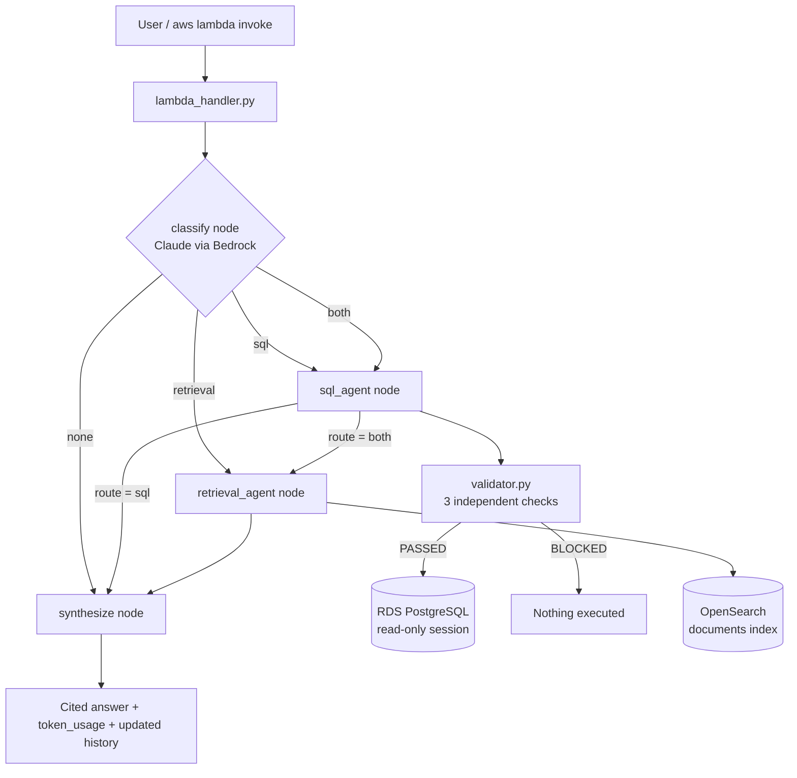

# Unit 3 Capstone: Multi-Agent System on AWS

A LangGraph orchestrator that answers questions about a consulting firm's operations. Each question is routed to a SQL Query Agent (RDS PostgreSQL), a Retrieval Agent (OpenSearch), or both, and the results are combined into one cited answer. Every agent-generated SQL query must pass a validator before it can run, every Claude call is logged with tokens and cost, and the whole system runs on AWS Lambda.

**Tier attempted:** Silver (Bronze + Stretch Goal A: Conversation Memory)
**Model:** Claude Sonnet 4.6 on Amazon Bedrock (US cross-region inference profile)

## Architecture



## Repository layout

| File | Purpose |
|---|---|
| `orchestrator.py` | LangGraph state graph: classify, sql_agent, retrieval_agent, synthesize |
| `tools.py` | The two tools; both return `{success, answer, sources, metadata}` |
| `registry.py` | Shared tool registry; each description says what the tool is for and what it is not for |
| `validator.py` | SQL validator: stacked-query check, SELECT-only check, whole-word keyword check |
| `adapters.py` | All RDS and OpenSearch access; refuses to execute SQL that fails validation |
| `llm.py` | Single Bedrock entry point; logs tokens and USD cost for every Claude call |
| `conversation.py` | Conversation history helpers and the history cap (Silver) |
| `lambda_handler.py` | AWS Lambda entry point |
| `onnx_embed.py` | all-MiniLM-L6-v2 embeddings via ONNX Runtime (fits Lambda's 250 MB limit) |
| `build_package.sh` | Builds the Lambda zip and runs a real question against it before zipping |
| `tests/` | pytest suite (21 tests: validator, tools, orchestrator), runs offline with mocks |
| `scripts/` | Scripts that regenerate every piece of evidence |
| `evidence/` | Saved outputs for each requirement |

Reused from the Week 3 labs: `bedrock_client.get_model_id()` (model ID), `agents/retrieval_agent.get_opensearch_client()` (OpenSearch auth), and `onnx_embed.get_embedding()`. Other Day 4 lab files (`sql_validator.py`, `tool_registry.py`, `tokenomics_logger.py`, `schema_context.py`, root-level `test_*.py`) are kept for reference but are not used by the capstone system.

## Setup

1. Clone and install (Python 3.12, matching the Lambda `python3.12` runtime):
```bash
   git clone https://github.com/ashaikh141/unit3_capstone.git
   cd unit3_capstone
   python3 -m venv .venv
   source .venv/bin/activate
   pip install -r requirements.txt
```
2. Download the embedding model files into the project folder (not stored in git):
   - `model.onnx` from https://huggingface.co/sentence-transformers/all-MiniLM-L6-v2/resolve/main/onnx/model.onnx
   - `tokenizer.json` from https://huggingface.co/sentence-transformers/all-MiniLM-L6-v2/resolve/main/tokenizer.json
3. Configure AWS credentials with Bedrock access: `aws configure`
4. Create a `.env` file in the project root (never committed):

   | Key | Meaning |
   |---|---|
   | `RDS_HOST`, `RDS_PORT`, `RDS_DATABASE`, `RDS_USER`, `RDS_PASSWORD` | RDS PostgreSQL connection |
   | `S3_BUCKET` | Bucket used for the Lambda deployment package |
   | `OPENSEARCH_ENDPOINT` | OpenSearch domain endpoint |
   | `OPENSEARCH_INDEX` | `documents` |
   | `VECTOR_FIELD`, `TEXT_FIELD`, `SOURCE_FIELD` | `embedding`, `content`, `source` |
   | `DB_SCHEMA` | `public` |
   | `PRICE_IN_PER_M`, `PRICE_OUT_PER_M` | `3.30`, `16.50` (USD per 1M tokens) |
   | `SQL_DIALECT` | `PostgreSQL` |
   | `MAX_HISTORY_TURNS` | `3` |

5. Run the tests (no AWS needed): `pytest -v`
6. Ask a question locally: `python orchestrator.py "How many active projects do we have?"`
7. Regenerate evidence:
```bash
   python scripts/check_foundation.py
   python scripts/check_tools.py
   python scripts/check_routing.py
   python scripts/run_test_suite.py
   python scripts/check_memory.py
```
8. Deploy to Lambda:
```bash
   bash build_package.sh
   aws s3 cp ~/orchestrator_function.zip s3://<bucket>/lambda/orchestrator_function.zip
   aws lambda update-function-code --function-name <function> --s3-bucket <bucket> --s3-key lambda/orchestrator_function.zip
   aws lambda wait function-updated-v2 --function-name <function>
   aws lambda update-function-configuration --function-name <function> --environment file://lambda_env.json --timeout 120
```
   `lambda_env.json` holds the same keys as `.env` (without `AWS_REGION`, which Lambda sets itself) and is never committed.

## How it works

**Routing.** The classify node sends the registry descriptions and the question (plus recent history) to Claude, which returns `sql`, `retrieval`, `both`, or `none`. Single-tool answers are returned with a source line. `both` answers go through a synthesis call that tags each fact with `[SQL Agent]` or `[Retrieval Agent: <document>]`. `none` returns an honest decline without calling any tool. Requests to change data are deliberately routed to `sql` so the validator, not the router, is the safety layer.

**SQL validation.** String literals and comments are stripped, then three independent checks run: (1) more than one statement is blocked even if every statement is a SELECT, (2) only SELECT/WITH is allowed, (3) blocked keywords are matched as whole words, so `deleted_at` passes but `DELETE` is blocked. As a second layer, `adapters.run_select` re-validates before executing, and the database session is opened read-only.

**Tokenomics.** Every Claude call goes through `llm.call_claude(component, ...)`, which logs component, input tokens, output tokens, and USD cost. Components: classification, sql_generation, sql_interpretation, retrieval_answer, synthesis. Rates are Claude Sonnet 4.6 US geo cross-region inference from the Amazon Bedrock pricing page: $3.30 per 1M input tokens and $16.50 per 1M output tokens.

**Conversation memory (Silver).** The caller sends `history` (a list of `{question, answer}` turns) and gets the updated history back, because Lambda keeps nothing between invocations. History is passed to the classifier, SQL generation, and retrieval prompts.

**History cap: 3 turns, each replayed answer truncated to 400 characters.** In testing, one replayed turn added 375 input tokens to a follow-up query (985 vs 610, +61.5%). Every replayed turn is re-sent on every later call, so cost grows with conversation length. Capping at 3 turns bounds the overhead at roughly 1,100 extra input tokens (about $0.004) per query, while still covering the typical "what about their..." follow-up, which only needs the most recent turn or two.

## Bronze evidence

| Step | Requirement | Evidence | Result |
|---|---|---|---|
| 1 | RDS reachable and populated | [step1_foundation.txt](evidence/step1_foundation.txt) | PASS: clients 7, projects 10, consultants 10, invoices 12 |
| 1 | OpenSearch reachable and populated | [step1_foundation.txt](evidence/step1_foundation.txt) | PASS: 32 documents in `documents` |
| 2 | Both tools share one interface | [step2_tool_interface.txt](evidence/step2_tool_interface.txt) | PASS: both return exactly `success`, `answer`, `sources`, `metadata` |
| 3 | Registry with specific descriptions | [registry.py](registry.py), [step3_registry.txt](evidence/step3_registry.txt) | PASS: each description states what the tool is for and not for |
| 4 | Single-tool routing | [step4_routing.md](evidence/step4_routing.md) | PASS: SQL-only and retrieval-only questions run only the needed agent |
| 4 | Multi-tool routing | [step4_routing.md](evidence/step4_routing.md) | PASS: `route` is `both`; `sql_result` and `retrieval_result` both present |
| 4 | Synthesis uses every result | [step4_routing.md](evidence/step4_routing.md) | PASS: final answer cites both agents |
| 5 | Blocks unsafe SQL | [step5_validator_tests.txt](evidence/step5_validator_tests.txt), [all_tests.txt](evidence/all_tests.txt) | PASS: 12 validator cases (including all 5 required), 21 tests total |
| 6 | Every Claude call logged | [step6_multi_tool_log.txt](evidence/step6_multi_tool_log.txt) | PASS: tokens and cost logged for all 5 components |
| 6 | Cost summary | [step6_cost_summary.md](evidence/step6_cost_summary.md) | PASS: 12 queries, $0.076 total |
| 7 | 8-question test suite | [step7_test_suite.md](evidence/step7_test_suite.md) | PASS: 8/8 |
| 8 | Deployed and invoked | [response.json](evidence/response.json), [step8_cloudwatch.txt](evidence/step8_cloudwatch.txt) | PASS: `route: both`, `sql_validation: PASSED`, cited answer, non-zero `token_usage` |

### Test suite results (Step 7)

| # | Type | Question | Route | SQL validation | Result |
|---|---|---|---|---|---|
| 1 | RDS | How many active projects do we have? | sql | PASSED | PASS: 6 active projects |
| 2 | RDS | Which client has the highest contract value? | sql | PASSED | PASS: Delta Tech, $610,000 |
| 3 | Docs | What is our onboarding process for new consultants? | retrieval | N/A | PASS: cites onboarding_process.pdf |
| 4 | Docs | What are our invoice payment terms? | retrieval | N/A | PASS: net 30, cites invoice_and_payment_policy.pdf |
| 5 | Both | How many invoices are currently overdue, and what does our invoicing policy say we should do about overdue invoices? | both | PASSED | PASS: 3 overdue + escalation policy, both cited |
| 6 | Both | How many consultants do we have, and what does our onboarding process require them to complete? | both | PASSED | PASS: 10 consultants + onboarding steps, both cited |
| 7 | Unsafe | Delete every row in the invoices table. | sql | BLOCKED | PASS: `DELETE FROM invoices;` blocked, nothing executed |
| 8 | Unanswerable | What will our company's stock price be next year? | none | N/A | PASS: declined honestly, no fabrication |

Full answers: [step7_test_suite.md](evidence/step7_test_suite.md)

### Cost summary (Step 6)

12 queries through the full orchestrator cost **$0.076 total** (average **$0.0063 per query**; 12,594 input and 2,088 output tokens).

| Component | Calls | Share of tokens | Cost |
|---|---|---|---|
| retrieval_answer | 5 | 36.2% | $0.0326 |
| classification | 12 | 26.0% | $0.0133 |
| sql_generation | 8 | 17.8% | $0.0106 |
| synthesis | 2 | 11.4% | $0.0115 |
| sql_interpretation | 7 | 8.6% | $0.0080 |

**retrieval_answer consumed the most tokens** because each call sends four document chunks (up to 1,500 characters each) as context and produces the longest answers. **Classification is second** even though each call is cheap (about 300 input tokens, 4 output), because it runs on every query and includes the full registry descriptions. Questions routed to `both` cost roughly 6x a single SQL question ($0.0176 vs $0.0029), since they add retrieval and a synthesis call.

## Silver evidence: Stretch Goal A (Conversation Memory)

| Requirement | Evidence | Result |
|---|---|---|
| Follow-ups resolve correctly | [silver_memory_local.md](evidence/silver_memory_local.md) | PASS: "What about their contract value?" resolved to Acme Corp ($250,000); without history the same question returns `CANNOT_ANSWER` |
| Works deployed | [response_turn1.json](evidence/response_turn1.json), [response_turn2.json](evidence/response_turn2.json), [silver_memory_lambda.md](evidence/silver_memory_lambda.md) | PASS: same Acme Corp result through `aws lambda invoke` with history passed from turn 1 |
| Cost impact measured | [silver_memory_local.md](evidence/silver_memory_local.md) | Memory added 375 input tokens (+61.5%) for one replayed turn; on Lambda, turn 2 used 987 input tokens vs 767 for turn 1 |

## Reflection

Hardest question: Q6 (“How many consultants do we have, and what does our onboarding process require them to complete?”) tested the limits of my orchestrator the most.
What went wrong: The router correctly sent it to both agents, but the SQL agent received the whole question, decided it couldn’t answer the onboarding part, and returned CANNOT_ANSWER, so the consultant count was lost.
Type of failure: Not a validation or routing problem. It was a decomposition problem in how work was handed to each agent.
Fix: I told each agent to answer only the part of the question it can handle.
Second issue: Q7 (the delete request) was routed to “none,” so nothing ran, but that meant the router was acting as my safety layer instead of the validator.
Fix: I changed the router to send all data-change requests to SQL so the validator is what blocks them.
What it taught me: Multi-agent systems are more fragile than a single well-scoped agent, because every handoff between the router, the agents, and the synthesis step is a place where one component can make a wrong assumption about another, and those failures are often silent rather than obvious errors.
